<picture>
  <source media="(max-width: 640px)" srcset="./assets/hero-mobile.svg">
  
</picture>

  <a href="#selected-work">Selected work</a> &nbsp; / &nbsp;
  <a href="#the-toolkit">The toolkit</a> &nbsp; / &nbsp;
  <a href="#beyond-the-build">Beyond the build</a>

### Big ideas. Working systems.

I'm **Antonio**, a **Cloud & AI Engineer at Microsoft**. I connect cloud infrastructure, intelligent agents and a healthy obsession with understanding how things actually work.

This is my open lab: runnable experiments, reference architectures and hands-on courses. Less slideware. More source code.

## Selected work

<table>
<tr>
<td width="50%" valign="top">

### [Agent Hosting Lab](https://github.com/chapi-dev/agent-hosting-lab)

One agent. Four deployments. Real measurements. Comparing self-hosted, hosted and hybrid agent architectures on Azure.

<b>PYTHON / MICROSOFT FOUNDRY / CONTAINER APPS</b>

</td>
<td width="50%" valign="top">

### [Fabric Private Networking](https://github.com/chapi-dev/fabric-private-networking-cookbook)

An end-to-end cookbook for private connectivity in Microsoft Fabric: endpoints, data sources and on-premises networks.

<b>MICROSOFT FABRIC / PRIVATE LINK / BICEP</b>

</td>
</tr>
<tr>
<td width="50%" valign="top">

### [From Zero to Qubit](https://github.com/chapi-dev/Introduction-to-Quantum-Computing)

Ten hands-on levels from your first quantum circuit to error correction, with parallel Qiskit and Q# implementations.

<b>QISKIT / Q# / JUPYTER NOTEBOOKS</b>

</td>
<td width="50%" valign="top">

### [Telco, Meet DevSecOps](https://github.com/chapi-dev/telco-devsecops-demo)

A VNF/CNF lifecycle built on GitHub and Azure: GitOps, signed artifacts, policy enforcement and deployable infrastructure.

<b>AKS / ARGO CD / SIGSTORE / GITHUB ACTIONS</b>

</td>
</tr>
</table>

**Also in the lab:** [a cross-platform photo editor](https://github.com/chapi-dev/collage-studio), [adiabatic quantum computing](https://github.com/chapi-dev/Adiabatic-Quantum-Computing), [Fabric to Foundry over Private Link](https://github.com/chapi-dev/fabric-foundry-private-link) and [a hands-on GitHub Copilot workshop](https://github.com/chapi-dev/ghcopilot-optimization-workshop).

## The toolkit

| Layer | What I build with |
| :--- | :--- |
| **Cloud & platforms** | Azure, Kubernetes, Container Apps, Bicep, Terraform |
| **AI & developer experience** | Microsoft Foundry, AI agents, MCP, GitHub Copilot |
| **Code & automation** | Python, TypeScript, Go, Rust, PowerShell, GitHub Actions |
| **Data & connectivity** | Microsoft Fabric, Private Link, hybrid networking |
| **Quantum** | Qiskit, Q#, Jupyter, a willingness to question the obvious |

## Beyond the build

Curiosity doesn't stop at the last commit. Sometimes the next challenge is a quantum algorithm. Sometimes it's a new game.

<b>Open the side quest</b>

 

**Halo. Ratchet & Clank. Crash Bandicoot.** Different universes, same instinct: explore the map, understand the mechanics, take on the next impossible-looking challenge.

That energy makes it into the code, too.

 

Personal projects, experiments and opinions. Not official Microsoft guidance.

