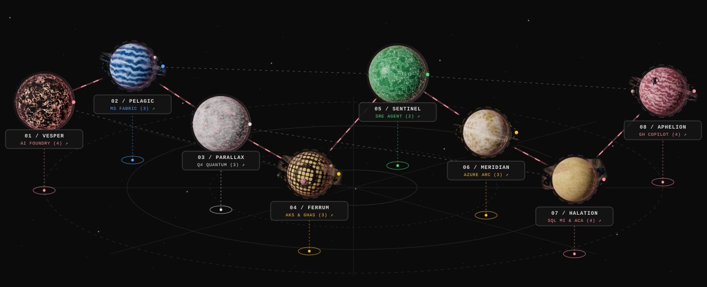
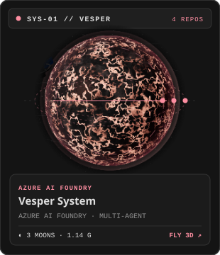
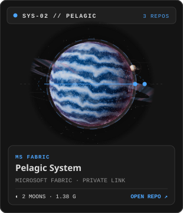
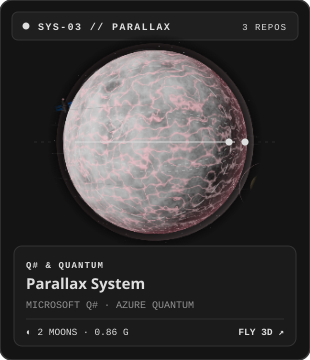
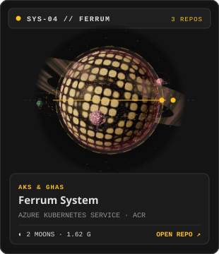
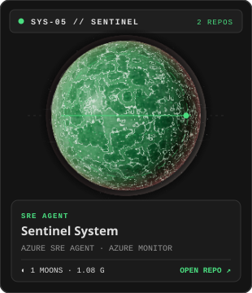
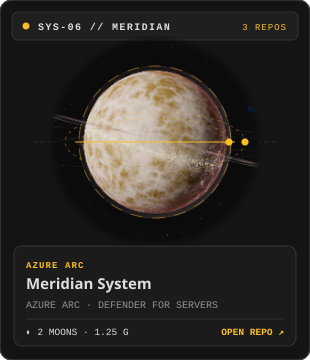
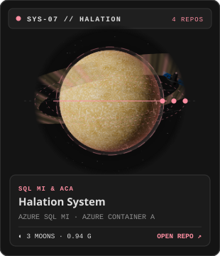
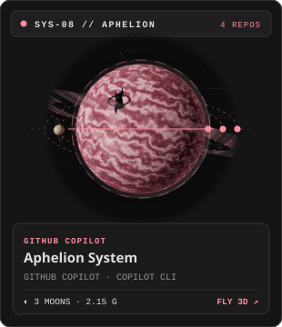

<a href="https://chapi-dev.github.io/chapi-dev/">
  <picture>
    <source media="(max-width: 640px)" srcset="./assets/distance-mobile.svg">
    
  </picture>
</a>

  <samp><b>3D TACTICAL SECTOR DECK</b> &middot; CLICK ANY PLANETARY SYSTEM TO ENGAGE ORBIT OR EXPAND CONSOLES BELOW</samp>

  
  
  
  

  
  
  
  

 

### Interactive System Telemetry &amp; Repository Consoles

<samp><b>[SYS-01 // VESPER]</b> Azure AI Foundry &amp; Multi-Agent Systems &mdash; 1 Planet + 3 Satellite Moons</samp>

| Celestial Body | Role &amp; Architecture | Stack | Repository |
| :--- | :--- | :--- | :--- |
| **&#9673; Vesper (Primary World)** | Hosted vs. self-hosted Azure AI Foundry agents across 4 architectures | `Azure AI Foundry` `Python` | [**`agent-hosting-lab`** &#8599;](https://github.com/chapi-dev/agent-hosting-lab) &middot; [3D Orbit &#8599;](https://chapi-dev.github.io/chapi-dev/?destination=vesper) |
| **&#9680; Moon: Aethel Foundry** | Multi-agent predictive maintenance orchestration with MCP | `Foundry` `MCP` | [**`agentic-factory-hack`** &#8599;](https://github.com/chapi-dev/agentic-factory-hack) |
| **&#9680; Moon: Lex-EU Relay** | EU digital sovereignty &amp; AI Act specialist agent with M365 shared mailbox ingestion | `Foundry` `Logic Apps` `Bicep` | [**`agente-soberania-digital-eu`** &#8599;](https://github.com/chapi-dev/agente-soberania-digital-eu) |
| **&#9680; Moon: Argus Trace** | End-to-end observability and telemetry for autonomous AI agents | `OpenTelemetry` `Foundry` | [**`agents-observability-tt202`** &#8599;](https://github.com/chapi-dev/agents-observability-tt202) |

<samp><b>[SYS-02 // PELAGIC]</b> Microsoft Fabric &amp; Zero-Trust Private Data Mesh &mdash; 1 Planet + 2 Satellite Moons</samp>

| Celestial Body | Role &amp; Architecture | Stack | Repository |
| :--- | :--- | :--- | :--- |
| **&#9673; Pelagic (Primary World)** | Complete Bicep cookbook for privatizing Microsoft Fabric (PE, MPE, OneLake, VNet Gateway) | `Microsoft Fabric` `Private Link` `Bicep` | [**`fabric-private-networking-cookbook`** &#8599;](https://github.com/chapi-dev/fabric-private-networking-cookbook) &middot; [3D Orbit &#8599;](https://chapi-dev.github.io/chapi-dev/?destination=pelagic) |
| **&#9680; Moon: Conduit-PL** | Microsoft Fabric calling Azure AI Foundry over Private Link with Managed Identity | `Fabric` `Foundry` `Private Link` | [**`fabric-foundry-private-link`** &#8599;](https://github.com/chapi-dev/fabric-foundry-private-link) |
| **&#9680; Moon: Capta Beacon** | Azure-native agentic platform on Microsoft Fabric &amp; AI Foundry for R&amp;D funding | `Fabric` `AI Foundry` | [**`Capta`** &#8599;](https://github.com/chapi-dev/Capta) |

<samp><b>[SYS-03 // PARALLAX]</b> Microsoft Q# &amp; Quantum Computing &mdash; 1 Planet + 2 Satellite Moons</samp>

| Celestial Body | Role &amp; Architecture | Stack | Repository |
| :--- | :--- | :--- | :--- |
| **&#9673; Parallax (Primary World)** | 10-level quantum computing curriculum from first circuits to Quantum Error Correction | `Microsoft Q#` `Qiskit` | [**`Introduction-to-Quantum-Computing`** &#8599;](https://github.com/chapi-dev/Introduction-to-Quantum-Computing) &middot; [3D Orbit &#8599;](https://chapi-dev.github.io/chapi-dev/?destination=parallax) |
| **&#9680; Moon: Eigen-AQC** | 11 interactive notebooks on Adiabatic Quantum Computing, Grover, 3-SAT &amp; MaxCut/QAOA | `Microsoft Q#` `Adiabatic` `QAOA` | [**`Adiabatic-Quantum-Computing`** &#8599;](https://github.com/chapi-dev/Adiabatic-Quantum-Computing) |
| **&#9680; Moon: Lifecycle Node** | Autonomous engineering lifecycle experiments | `Python` `Automation` | [**`agent_lifecycle`** &#8599;](https://github.com/chapi-dev/agent_lifecycle) |

<samp><b>[SYS-04 // FERRUM]</b> Azure Kubernetes Service (AKS) &amp; DevSecOps &mdash; 1 Planet + 2 Satellite Moons</samp>

| Celestial Body | Role &amp; Architecture | Stack | Repository |
| :--- | :--- | :--- | :--- |
| **&#9673; Ferrum (Primary World)** | 5G VNF/CNF lifecycle on AKS &amp; ACR with GitOps, Sigstore Cosign, GHAS &amp; Kyverno | `AKS` `ACR` `GHAS` `Kyverno` | [**`telco-devsecops-demo`** &#8599;](https://github.com/chapi-dev/telco-devsecops-demo) &middot; [3D Orbit &#8599;](https://chapi-dev.github.io/chapi-dev/?destination=ferrum) |
| **&#9680; Moon: Frontier-AKS** | Cloud-native microservice architecture on Azure Kubernetes Service | `AKS` `Kubernetes` | [**`frontier-aks-hackathon`** &#8599;](https://github.com/chapi-dev/frontier-aks-hackathon) |
| **&#9680; Moon: Telco-Spec** | Telecom &amp; 3GPP technical architecture specifications | `5G` `Telco Cloud` | [**`Telecom-Technical-Specifications`** &#8599;](https://github.com/chapi-dev/Telecom-Technical-Specifications) |

<samp><b>[SYS-05 // SENTINEL]</b> Azure SRE Agent &amp; Autonomous InfraOps &mdash; 1 Planet + 1 Satellite Moon</samp>

| Celestial Body | Role &amp; Architecture | Stack | Repository |
| :--- | :--- | :--- | :--- |
| **&#9673; Sentinel (Primary World)** | Automated Azure SRE Agent deployment, multi-pod AKS &amp; live break-fix scenarios | `Azure SRE Agent` `AKS` `PowerShell` | [**`azure-sre-agent-sandbox`** &#8599;](https://github.com/chapi-dev/azure-sre-agent-sandbox) &middot; [3D Orbit &#8599;](https://chapi-dev.github.io/chapi-dev/?destination=sentinel) |
| **&#9680; Moon: Architect-AI** | Agentic InfraOps transforming requirements into validated Azure diagrams, pricing &amp; IaC | `Copilot` `Bicep` `Azure Pricing` | [**`azure-agentic-infraops`** &#8599;](https://github.com/chapi-dev/azure-agentic-infraops) |

<samp><b>[SYS-06 // MERIDIAN]</b> Azure Arc, Defender &amp; Hybrid Virtual WAN &mdash; 1 Planet + 2 Satellite Moons</samp>

| Celestial Body | Role &amp; Architecture | Stack | Repository |
| :--- | :--- | :--- | :--- |
| **&#9673; Meridian (Primary World)** | Azure Arc for Linux fleets with Update Manager &amp; Microsoft Defender for Servers (MDE + FIM) | `Azure Arc` `Defender` `Update Manager` | [**`Arc-Linux`** &#8599;](https://github.com/chapi-dev/Arc-Linux) &middot; [3D Orbit &#8599;](https://chapi-dev.github.io/chapi-dev/?destination=meridian) |
| **&#9680; Moon: vWAN-Pulse** | Hybrid lab with Azure vWAN &amp; Arc-onboarded VM benchmarking DB latency over WAN | `Azure vWAN` `Azure Arc` | [**`azure-hybrid-latency-lab`** &#8599;](https://github.com/chapi-dev/azure-hybrid-latency-lab) |
| **&#9680; Moon: LazyAzure TUI** | Fast Go terminal UI for drilling down into Azure subscriptions, resource groups &amp; resources | `Azure ARM` `Go TUI` | [**`lazyazure`** &#8599;](https://github.com/chapi-dev/lazyazure) |

<samp><b>[SYS-07 // HALATION]</b> Azure SQL MI, Container Apps &amp; App Service &mdash; 1 Planet + 3 Satellite Moons</samp>

| Celestial Body | Role &amp; Architecture | Stack | Repository |
| :--- | :--- | :--- | :--- |
| **&#9673; Halation (Primary World)** | Cross-region online migration from SQL Server to Azure SQL Managed Instance via MI Link | `Azure SQL MI` `PowerShell` | [**`sql-mi-link-demo`** &#8599;](https://github.com/chapi-dev/sql-mi-link-demo) &middot; [3D Orbit &#8599;](https://chapi-dev.github.io/chapi-dev/?destination=halation) |
| **&#9680; Moon: Vault-NFS** | Automated snapshot backups for Azure Files NFS via Azure Automation Runbooks | `Azure Files NFS` `Automation` | [**`azure-files-nfs-backup`** &#8599;](https://github.com/chapi-dev/azure-files-nfs-backup) |
| **&#9680; Moon: Deck-ACA** | AI-powered presentation builder from local dev to Azure Container Apps | `Azure Container Apps` `TypeScript` | [**`Presentation_maker`** &#8599;](https://github.com/chapi-dev/Presentation_maker) |
| **&#9680; Moon: Collage-App** | Cross-platform TypeScript layout studio deployed to Azure App Service with Bicep &amp; Actions | `Azure App Service` `Bicep` `React` | [**`collage-studio`** &#8599;](https://github.com/chapi-dev/collage-studio) |

<samp><b>[SYS-08 // APHELION]</b> GitHub Copilot Enterprise &amp; Agentic DevEx &mdash; 1 Planet + 3 Satellite Moons</samp>

| Celestial Body | Role &amp; Architecture | Stack | Repository |
| :--- | :--- | :--- | :--- |
| **&#9673; Aphelion (Primary World)** | Hands-on workshop for optimizing GitHub Copilot usage &amp; tokens across the SDLC | `GitHub Copilot` `Agentic SDLC` | [**`ghcopilot-optimization-workshop`** &#8599;](https://github.com/chapi-dev/ghcopilot-optimization-workshop) &middot; [3D Orbit &#8599;](https://chapi-dev.github.io/chapi-dev/?destination=aphelion) |
| **&#9680; Moon: Enterprise-Gov** | Enterprise GitHub Copilot governance, FinOps, MCP/Skills &amp; 90-day rollout blueprint | `Copilot Enterprise` `MCP` `FinOps` | [**`telefonica-copilot-workshop`** &#8599;](https://github.com/chapi-dev/telefonica-copilot-workshop) |
| **&#9680; Moon: Universe-26** | GitHub Universe agentic engineering showcase | `GitHub Copilot` `Python` | [**`copilot-app-universe26-demo`** &#8599;](https://github.com/chapi-dev/copilot-app-universe26-demo) |
| **&#9680; Moon: Rust-Core** | Self-paced Rust 101 deep dive with 15 executable generics labs | `Rust` `Systems` | [**`rust101`** &#8599;](https://github.com/chapi-dev/rust101) |

 

  <samp><a href="https://chapi-dev.github.io/chapi-dev/"><b>&#9654; LAUNCH FULL-SCREEN 3D COCKPIT &amp; FREE FLIGHT (WASD + HOLOMAP)</b></a></samp> 
  Fictional worlds. Real Microsoft engineering. Personal work, not official Microsoft material.

