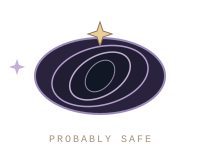

<h1 align="center">hey, i'm antonio.</h1>

  <samp>cloud &amp; AI engineer @ Microsoft</samp> 
  <samp>currently keeping a tiny solar system in a stable-ish orbit.</samp>

 

<h2 align="center">my side projects have developed gravity.</h2>

  <samp>six unlikely worlds. a few restless satellites. absolutely no respect for scale.</samp>

<h3 align="center">choose your landing</h3>

<samp>each little world below is a real project. click one to visit.</samp>

<!-- SVG image links are inert on GitHub, so landing pads use ordinary HTML links. -->

  <samp><a href="https://github.com/chapi-dev/Introduction-to-Quantum-Computing">Qubit-9</a> / <a href="https://github.com/chapi-dev/agent-hosting-lab">Foundria</a> / <a href="https://github.com/chapi-dev/fabric-private-networking-cookbook">Nimbus-7</a></samp> 
  <samp><a href="https://github.com/chapi-dev/telco-devsecops-demo">Gitopia</a> / <a href="https://github.com/chapi-dev/collage-studio">Pixelune</a> / <a href="https://github.com/chapi-dev/ghcopilot-optimization-workshop">Copilotia</a></samp>

  <i>please don't observe the cat. we haven't committed its state yet.</i>

<b>Lost in space? Unfold the flight plan.</b>

 

| World | What lives there |
| :--- | :--- |
| [**Qubit-9**](https://github.com/chapi-dev/Introduction-to-Quantum-Computing) | A cat-eared quantum world. Ten levels of Qiskit and Q#, from first circuits to error correction. |
| [**Foundria**](https://github.com/chapi-dev/agent-hosting-lab) | A planet-sized agent workshop. One agent, four deployments, measured on real infrastructure. |
| [**Nimbus-7**](https://github.com/chapi-dev/fabric-private-networking-cookbook) | A very private cloud. Microsoft Fabric connectivity, endpoints and hybrid networks. |
| [**Gitopia**](https://github.com/chapi-dev/telco-devsecops-demo) | Where cargo needs a signature. GitOps, AKS, supply-chain security and policy enforcement. |
| [**Pixelune**](https://github.com/chapi-dev/collage-studio) | A moon made of little pictures. A photo collage editor for web, iOS and Android. |
| [**Copilotia**](https://github.com/chapi-dev/ghcopilot-optimization-workshop) | An outpost for curious builders. A hands-on GitHub Copilot workshop. |

 

  <samp>psst. the wormhole is not a decoration.</samp> 
  

<h3 align="center">back on this planet</h3>

  I build cloud infrastructure, AI agents and experiments you can actually run. 
  Occasionally, the experiments escape and become small illustrated planets.

  <samp>Azure &middot; Microsoft Foundry &middot; Python &middot; TypeScript &middot; Qiskit &middot; Q#</samp>

A personal universe. Not an official Microsoft galaxy.

